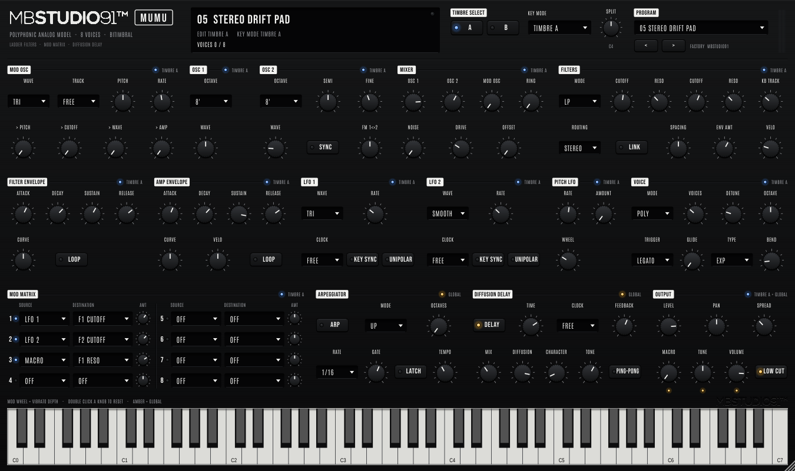

# MBStudio91 MuMU

Sintetizzatore polifonico analogico virtuale con pannello in stile hardware MBStudio91. L'architettura prende come modello il Moog Muse, così come lo descrive la recensione di Sound On Sound (https://www.soundonsound.com/reviews/moog-muse). Formati: VST3, AU (Mac) e Standalone.



## Cosa c'è

- 8 voci, due timbri (A e B) per patch. KEY MODE: solo A, solo B, layer (A+B sulla stessa nota) o split con punto di divisione regolabile (A sopra, B sotto).
- Ogni timbro può essere POLY, MONO o UNISON (da 2 a 8 voci, con detune e apertura stereo). In mono si sceglie se ripartire o suonare legato.
- Glide in tre modi: esponenziale, velocità costante, tempo costante.
- OSC 1 e OSC 2 con forma d'onda continua (triangolo, dente di sega, quadra, impulso stretto) e anti-aliasing PolyBLEP. Ottave da 32' a 1'; OSC 2 con semitoni, fine, hard sync e FM bipolare (verso destra OSC 1 modula OSC 2, verso sinistra il contrario).
- MOD OSC: un terzo oscillatore con onde sinusoide, triangolo, dente di sega, quadra e S&H. Può seguire la tastiera (audio) o andare libero da 0,05 Hz a 1 kHz. Ha mandate dirette verso pitch, cutoff, forma d'onda e ampiezza, e può entrare nel mixer.
- Mixer con OSC 1, OSC 2, MOD OSC, ring modulator (1 x 2) e rumore bianco. Il DRIVE porta in saturazione, l'OFFSET rende la saturazione asimmetrica.
- Due filtri ladder a 4 poli (24 dB/ottava) con saturazione e autooscillazione intonata: F1 passa-basso o passa-alto, F2 passa-basso. Collegamento in serie, parallelo o stereo (F1 a sinistra, F2 a destra). Con LINK il cutoff di F2 comanda entrambi e SPACING fissa la distanza in ottave: così si ottengono notch e passa-banda.
- Inviluppi ADSR per filtro e ampiezza, con curva regolabile, loop (diventano modulatori ciclici) e ripartenza dal valore corrente.
- Due LFO (7 forme, fino a 1 kHz, sincronizzabili al tempo, key sync, unipolari) e un LFO di pitch dedicato al vibrato, comandato anche dalla rotella.
- MOD MATRIX con 8 slot per timbro: 12 sorgenti e 21 destinazioni, quantità bipolare.
- Arpeggiatore: UP, DOWN, UP-DOWN, RANDOM, ORDER; da 1 a 4 ottave, valori da 1/4 a 1/32 (anche terzine), gate, latch. Segue il tempo della DAW, altrimenti usa il TEMPO interno.
- DIFFUSION DELAY stereo con ping-pong, diffusione (8 allpass in ingresso e 6 nel ritorno), tono e CHARACTER: a destra la diffusione si fa più densa, a sinistra viene modulata da 6 LFO come un chorus.
- Uscita con taglio dei bassi a 6 dB/ottava (80 Hz), accordatura generale (+/-100 cent) e MACRO assegnabile nella matrice.
- 18 preset di fabbrica MBStudio91 originali, livellati a circa -22 dBFS RMS.

## Pannello

- TIMBRE SELECT (A/B): sceglie quale timbro stai modificando. LED e manopole sono blu per A e verdi per B. I comandi con il LED ambra sono globali (arpeggiatore, delay, volume, macro, accordatura, key mode).
- Il display mostra la patch, il timbro in modifica e il parametro che stai muovendo con il suo valore.
- Doppio clic su una manopola: torna al valore iniziale.
- La finestra si ridimensiona dall'angolo in basso a destra.

## Prove fatte su questa versione

- Render offline di tutti i preset (tools/render.cpp): nessun valore non valido. A 48 kHz, con buffer da 256 campioni, un blocco richiede in media tra l'1 e il 5% del tempo disponibile, a seconda del preset (misurato su un server Linux, un solo core).
- Aliasing misurato su C7 tenuto, a filtro aperto: componenti non armoniche tra -37 e -48 dB rispetto alle armoniche.
- Autooscillazione dei filtri con key track al 100%: intonata entro 11 cent su C3, C4 e C5.
- pluginval a strictness 10 superato (VST3, Linux).

## Limiti attuali (prototipo 0.1)

- Sequencer a 64 passi, memoria degli accordi e Coin Toss non ci sono ancora; c'è solo l'arpeggiatore.
- La matrice ha 8 slot invece di 16 e mancano le funzioni matematiche sulle sorgenti.
- Oscillatori e filtri lavorano senza sovracampionamento: sulle note più acute, con forme d'onda brillanti, un po' di aliasing si sente.
- I tempi degli inviluppi, la curva del drive e il carattere del delay sono tarati a orecchio. Non sono misurati su uno strumento reale.
- Niente aftertouch polifonico né MPE (come nello strumento di riferimento).

## Compilare su Mac

Servono Xcode e CMake (`brew install cmake`).

```
cmake -S . -B build -G Xcode
cmake --build build --config Release --target MBStudio91MuMU_VST3 MBStudio91MuMU_AU MBStudio91MuMU_Standalone
```

JUCE 9.0.5 si scarica da solo. Per usare una copia locale aggiungi `-DJUCE_DIR=/percorso/JUCE`.

I file compilati sono in `build/MBStudio91MuMU_artefacts/Release/`. Copiali così:
- `MBStudio91 MuMU.vst3` in `~/Library/Audio/Plug-Ins/VST3/`
- `MBStudio91 MuMU.component` in `~/Library/Audio/Plug-Ins/Components/`
- `MBStudio91 MuMU.app` in `Applicazioni`

Ogni push su GitHub avvia il workflow `.github/workflows/build.yml`, che compila le versioni per Mac (universale Intel/Apple Silicon) e Windows. I file pronti sono in Actions > ultima esecuzione > Artifacts.

Strumento di prova: `-DMUMU_BUILD_TOOLS=ON`, poi `mumu_render cartella` (render dei preset in WAV) oppure `mumu_render cartella test` (aliasing, autooscillazione, furto di voci, mono e glide).

## Licenza

MuMU è distribuito sotto GNU AGPL v3 (vedi `LICENSE.md`), compatibile con JUCE (AGPL v3). Font Bebas Neue e Antonio sotto SIL Open Font License (`MBStudioUI/fonts/OFL-*.txt`).

Moog e Muse sono marchi di Moog Music Inc. Sono citati solo per descrivere a quale architettura si ispira il progetto: MuMU non è affiliato a Moog Music e non contiene codice, campioni o preset di Moog.
